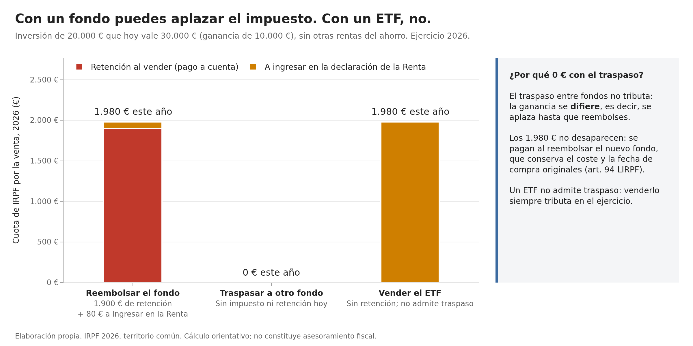
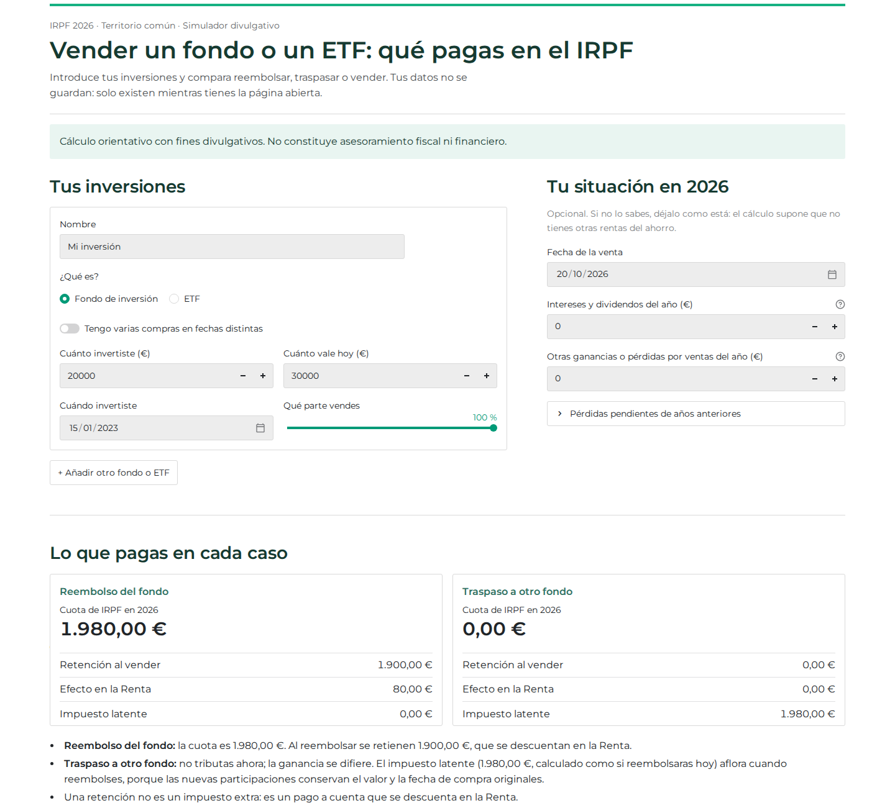
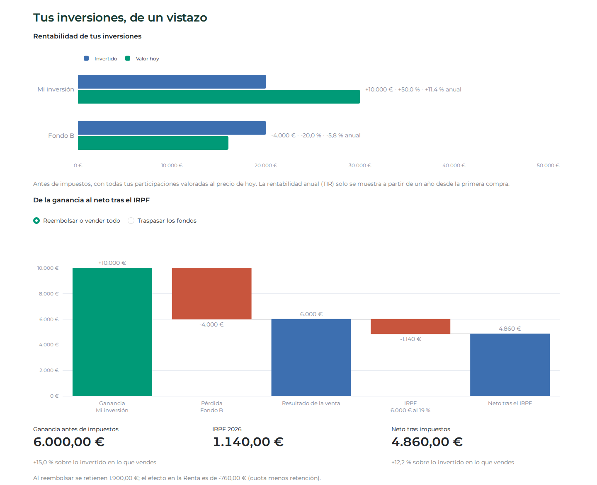

# Simulador fiscal: vender un fondo o un ETF (IRPF, España)

Calcula y compara el coste en el IRPF de deshacer una inversión de tres formas: **reembolsar un fondo**, **traspasarlo a otro fondo** o **vender un ETF**. Residentes en territorio común, ejercicio 2026.

**Pruébalo en la web:** [simulador-fiscal-fondos-etf.streamlit.app](https://simulador-fiscal-fondos-etf.streamlit.app/). Si está en reposo, pulsa el botón para activarla; tarda unos segundos.

> Cálculo orientativo con fines divulgativos. No constituye asesoramiento fiscal ni financiero.

## El problema

Con la incertidumbre en los mercados, muchos inversores se plantean vender sin saber qué implica fiscalmente. La diferencia entre fondo y ETF es importante y poco conocida:

- Con un **fondo** se puede reducir riesgo con un **traspaso** (por ejemplo, a un monetario) sin tributar hoy: la ganancia se difiere hasta el reembolso (art. 94.1.a LIRPF).
- Un **ETF** no admite traspaso: venderlo siempre tributa en el ejercicio.
- El **reembolso** de un fondo lleva una retención del 19 % y la **venta** de un ETF no; aun así, la cuota final en la Renta es la misma.

Caso de ejemplo: 20.000 € invertidos que hoy valen 30.000 €, sin otras rentas del ahorro.

| | Reembolsar el fondo | Traspasar a otro fondo | Vender el ETF |
|---|---|---|---|
| Cuota de IRPF en 2026 | 1.980 € | 0 € | 1.980 € |
| Retención al vender | 1.900 € | 0 € | 0 € |
| A ingresar en la Renta | 80 € | 0 € | 1.980 € |
| Impuesto aplazado | — | 1.980 € | — |

Cuota: 6.000 € al 19 % + 4.000 € al 21 % (escala progresiva del ahorro).



## La aplicación

[Abrir la app](https://simulador-fiscal-fondos-etf.streamlit.app/). Una app web en Streamlit pensada para cualquier inversor, sin conocimientos técnicos:

- **Entrada guiada por inversión**: qué es (fondo o ETF), cuánto invertiste, cuándo, cuánto vale hoy y qué parte vendes. Para quien tenga varias compras, un modo detallado aplica el método FIFO.
- **Varias inversiones a la vez**: una operación por producto (reembolsar, traspasar o vender) y dos planes de referencia para comparar: «reembolsar o vender todo» y «traspasar los fondos».
- **Situación personal opcional**: intereses y dividendos del año, otras ganancias o pérdidas y pérdidas pendientes de los cuatro ejercicios anteriores.
- **Resultado** con la cuota, la retención, el efecto en la Renta, el impuesto latente del traspaso, los saldos que se arrastran o caducan y avisos (regla de recompra, régimen transitorio de ETF).
- **Visualización**: rentabilidad de cada inversión (total y anual) y una cascada de la ganancia al neto tras el IRPF, con el impuesto desglosado por tramos y el ahorro por compensaciones.
- **Privacidad**: no guarda datos; solo existen mientras la página está abierta.





## Fundamento normativo

Cada regla vive en [`simulador/normativa.py`](simulador/normativa.py) con su artículo, su fuente y su fecha de verificación. Fuentes y enlaces en [`docs/fuentes.md`](docs/fuentes.md).

| Regla | Norma |
|---|---|
| Escala del ahorro (19 / 21 / 23 / 27 / 30 %) | Arts. 66 y 76 LIRPF (Ley 7/2024) |
| Ganancia patrimonial y gastos de compra y venta | Arts. 34 y 35 LIRPF |
| FIFO por grupo de valores homogéneos | Arts. 37.2 y 94.1.a LIRPF; art. 8 RIRPF; DGT V0796-26 |
| Traspaso entre fondos sin tributar; exclusión de los ETF | Art. 94.1.a y 94.2.a LIRPF |
| Retención del 19 % en el reembolso de fondos | Art. 101.6 LIRPF; arts. 96 y 97 RIRPF |
| Venta de ETF sin retención | Art. 75.3.j RIRPF |
| Compensación de rentas del ahorro (límite del 25 %, arrastre de 4 años) | Art. 49 LIRPF; Manual práctico de Renta 2025 de la AEAT |
| Regla de recompra (solo aviso) | Art. 33.5.f y g LIRPF |
| Régimen transitorio de ETF extranjeros (solo aviso) | DT 36.ª LIRPF |

## Decisiones técnicas

- **`Decimal` para todo importe**, nunca `float`. Se redondea a céntimos solo al presentar el resultado.
- **Núcleo de cálculo puro y separado de la interfaz.** `simulador/` no tiene entrada/salida ni estado global; la app y los gráficos solo llaman a sus funciones.
- **Cuota incremental.** La cuota atribuible a una venta es la de la base del ahorro con la venta menos la de sin ella, después de compensar con el resto de rentas del año. Con varios productos se muestra en total: con una escala progresiva no hay una forma única de repartirla entre ellos.
- **Compensación completa del art. 49 LIRPF**, en los dos sentidos, con arrastre y caducidad a cuatro años y el orden y el límite conjunto del 25 % del Manual de Renta de la AEAT.
- **Rentabilidad anual por TIR** (bisección con `Decimal`), que pondera cuándo entró cada euro. No se anualizan periodos inferiores a un año.
- **Tests con casos resueltos a mano.** Cada cálculo se contrasta con un caso desarrollado paso a paso en [`examples.md`](.claude/skills/calculo-plusvalias/examples.md), incluido el caso práctico de compensación del Manual de la AEAT. 107 tests con `pytest`, también de la app completa.
- **App siempre disponible.** Streamlit Community Cloud pone en reposo las apps sin visitas; una tarea de GitHub Actions ([`despertar-app.yml`](.github/workflows/despertar-app.yml)) la abre cada 8 horas con un navegador y la despierta si hace falta, y se reactiva sola para que GitHub no la desactive por inactividad.
- **Gráficos accesibles.** Paletas validadas para daltonismo y contraste; los gráficos dibujan los resultados del simulador, nunca cifras propias.

## Estructura

```
simulador/
  normativa.py      Reglas fiscales con artículo, fuente y fecha de verificación
  lotes.py          Compras por lotes y asignación FIFO
  calculo.py        Ganancia patrimonial, cuota por tramos y su desglose, retención
  compensacion.py   Integración y compensación de rentas del ahorro (art. 49 LIRPF)
  escenarios.py     Reembolso, traspaso y venta de ETF; planes con varias inversiones
  rentabilidad.py   Rentabilidad total y anual (TIR)
  graficos.py       Gráficos de LinkedIn y de la app
app.py              Interfaz en Streamlit
tests/              Un fichero de tests por módulo
.github/            Tarea programada que mantiene despierta la app publicada
contenido/          Posts de LinkedIn con su gráfico y su caso reproducible
docs/               Fuentes normativas y capturas
```

## Ejecutarlo en local

Requiere Python 3.11 o superior.

```bash
python -m venv .venv
source .venv/bin/activate
pip install -r requirements.txt

pytest -q                     # tests
streamlit run app.py          # app en http://localhost:8501
```

Para regenerar los gráficos de `contenido/`, que se exportan a PNG con Chrome:

```bash
plotly_get_chrome             # una sola vez
python -m simulador.graficos
```

## Alcance y limitaciones

- IRPF de residentes en territorio común, ejercicio 2026. No cubre País Vasco ni Navarra, no residentes, personas jurídicas ni el Impuesto sobre el Patrimonio.
- Supone un contribuyente con un salario estándar, cuya base general absorbe el mínimo personal y familiar (art. 66.1.2.º LIRPF).
- Cada producto está en una sola entidad comercializadora (art. 97.2 RIRPF).
- La regla de recompra y el régimen transitorio de ETF extranjeros solo se avisan, no se calculan.


## Cómo se ha desarrollado

De manera individual y con Claude Code como asistente de programación, bajo reglas explícitas del proyecto ([`CLAUDE.md`](CLAUDE.md)): ninguna norma sin artículo y fuente, todo cálculo con un caso resuelto a mano, commits pequeños y una revisión documentada antes de cada integración ([`.claude/skills/`](.claude/skills/)). Las decisiones fiscales y su verificación son del autor.

## Licencia

[MIT](LICENSE). El código se puede reutilizar citando al autor y se ofrece sin garantía de ningún tipo; los resultados no sustituyen el asesoramiento de un profesional.

## Autor

Kike Álvarez, estudiante de último curso del Doble Grado en Derecho y ADE en la Universidade da Coruña, orientado a la fiscalidad patrimonial.

[LinkedIn](https://www.linkedin.com/in/enriquealvarezcosmea)
